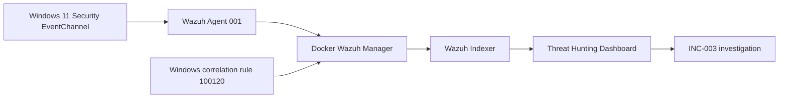
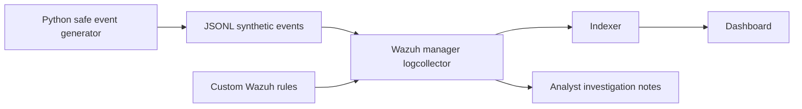

# SOC Detection & Incident Response Lab

**A defensive cybersecurity portfolio project** built around Wazuh SIEM, Windows endpoint telemetry, safe synthetic test data, reproducible detection rules, and analyst-style investigations.

> **Status: Two validated lab phases (7–8 November 2026).** Phase 1 verified manager-local synthetic JSON detections. Phase 2 verified **real Windows Security EventChannel telemetry** from an active Wazuh endpoint agent (`001`) and a custom five-event failed-logon correlation (`100120`, level 10). All authentication failures were deliberately induced against a nonexistent test username; no real attack or compromise occurred.

## Why this project exists

This project demonstrates a realistic, limited SOC workflow: ingest logs → identify suspicious behavior → validate alerts → investigate → document conclusions and limitations. It uses **harmless synthetic JSON test records** in Phase 1 and **controlled, real Windows Security events** in Phase 2; it does not carry out attacks or execute malware.

## Phase 1 — Verified synthetic detection results

Tested on **7 November 2026** using the official Wazuh **4.14.10** single-node Docker stack on Windows + Docker Desktop/WSL2. Events were injected as synthetic JSON lines into `/var/ossec/logs/lab-events.jsonl`. Wazuh decoded, correlated where applicable, and indexed the corresponding alerts.

| Scenario | Wazuh rule | Level | MITRE ATT&CK | Observed result |
| --- | --- | --- | --- | --- |
| Individual simulated failed login | `100100` | 3 | T1110 | Base authentication-failure events visible in dashboard |
| **Five failed logins** from `192.0.2.44` within the correlation window | **`100101`** | **10** | **T1110 — Brute Force** | **Frequency-5 correlation fired; indexed alert verified** |
| Synthetic suspicious PowerShell process indicator | **`100110`** | **8** | **T1059.001 — PowerShell** | **Custom rule fired; indexed alert verified** |

The observed synthetic authentication events referenced `demo_user` and `demo-win01`; the source IP `192.0.2.44` is an RFC 5737 documentation address. The PowerShell scenario described suspicious process metadata only—**no PowerShell command was executed**.

### Dashboard evidence

| Evidence | Screenshot |
| --- | --- |
| Wazuh Threat Hunting overview showing lab alerts | [Detection overview](screenshots/detection-overview.png) |
| Correlated authentication-failure alert (`100101`, level 10) | [Brute-force alert](screenshots/brute-force-alert.png) |
| Suspicious PowerShell indicator (`100110`, level 8) | [PowerShell alert](screenshots/powershell-alert.png) |


### SOC investigation write-ups

- [INC-001 — Repeated authentication failures (controlled simulation)](investigations/INC-001-brute-force-simulation.md)
- [INC-002 — Suspicious PowerShell indicator (controlled simulation)](investigations/INC-002-powershell-simulation.md)

**Scope and limitations:** These results verify synthetic log collection, JSON decoding, rule evaluation, frequency correlation, alert indexing, and dashboard visibility. They do **not** validate authentication against a real service, Windows endpoint telemetry, real PowerShell execution, incident containment, or a real-world compromise. ATT&CK mappings are hypotheses for detection coverage, not evidence of a completed attack.

## Phase 2 — Real Windows endpoint detection (validated 8 November 2026)

A Windows 11 endpoint running Wazuh agent **`001`** (`soc-win-endpoint`) was enrolled against the same Docker-hosted Wazuh manager. The endpoint collected real **Windows EventChannel** logs; unlike Phase 1, no fabricated JSON security events were injected.

| Verified test | Observed rule | Level | Evidence |
| --- | --- | --- | --- |
| Controlled Windows Application error (Event ID `777`) | `60602` | 9 | Wazuh received and alerted on the genuine Application-channel event |
| One deliberately failed local Windows logon (Security Event ID `4625`) | `60122` | 5 | Built-in failed-logon alert visible for agent `001` |
| **Five failed local logons for the same nonexistent username within 60 seconds** | **Custom `100120`** | **10** | **Frequency-5 correlation alert verified in dashboard and manager alerts; triggered on two test runs** |

The failed-logon tests called the Windows `LogonUser` API with the **nonexistent** `SOC_LAB_NONEXISTENT` account and an intentionally fake password. Windows recorded authentic Security Event ID `4625` events (interactive logon type `2`, unknown-user substatus `0xC0000064`). Wazuh decoded these via `windows_eventchannel`; its built-in rule `60122` generated level-5 alerts. Our `100120` rule correlated the failures for the same **target username**, mapped to **MITRE ATT&CK T1110 — Brute Force**.

- **Custom detection rule:** [`rules/windows_auth_rules.xml`](rules/windows_auth_rules.xml)
- **Investigation and sanitized evidence:** [INC-003 — Windows failed-logon correlation](investigations/INC-003-windows-authentication.md)
- **Observed correlated alerts:** 2026-11-08 17:48:55 CET and 17:50:28 CET (16:48:55 and 16:50:28 UTC).

**Scope:** This confirms true Windows-to-agent-to-SIEM detection and five-event correlation in a controlled environment, **not** a real brute-force attack. The test did not involve a remote source IP, real compromised account, malicious PowerShell, or actual adversary activity. Additional negative tests and tuning are required before production use.

### Phase 2 architecture



## Architecture



The Docker stack is supplied by the **official Wazuh project**, cloned locally (not vendored into this repository). Phase 1 uses manager-local synthetic records; Phase 2 uses a Windows host agent and real EventChannel records. Your own work consists of detection rules, test cases, deployment helper scripts, and analyst documentation.

## Requirements (Windows 10/11)

- PowerShell 5.1+; Python 3.10+ for the synthetic generator/tests; Git.
- Docker Desktop using **WSL2 Linux containers** (Docker Desktop license conditions may vary by organization; personal use is generally free).
- Wazuh single-node deployment: **4 CPU cores, at least 8 GB RAM available to Docker, and 50 GB free disk**, per Wazuh documentation. More memory on the host is recommended.
- Internet only for first downloads of official Wazuh sources/images; Python unit tests run offline without dependencies.
- Local testing only. Do not expose Wazuh ports to untrusted networks or reuse demonstration credentials.

## Fast start: offline tests first (no Docker)

Open PowerShell in the extracted project directory:

```powershell
py -3 --version
py -3 -m unittest discover -s tests -v
py -3 scripts/generate_events.py --scenario all --out samples/generated-events.jsonl
py -3 scripts/analyze_events.py samples/generated-events.jsonl
```

Expected: tests pass; generated events have `event_type`, and the analyzer reports an authentication-failure burst and one PowerShell indicator. The Python analyzer is a **local oracle**, not an implementation of Wazuh's own correlation engine.

## Wazuh Docker deployment on Windows

First, install WSL2 and Docker Desktop and start Docker Desktop. Run:

```powershell
wsl --status
docker version
docker compose version
```

If WSL isn't installed, see the official Microsoft documentation linked below. Before running the bootstrap, check the WSL2 kernel setting below. Then, with Docker Desktop open, run:

```powershell
.\scripts\setup-wazuh.ps1
```

This helper downloads the pinned official Wazuh Docker repository, configures the manager to watch a dedicated JSONL file, generates self-signed certificates, and starts its single-node stack. It **does not** install software on your system automatically; Docker Desktop, Python and Git must already be available. If PowerShell execution policy blocks the local script, inspect it and use a process-scoped policy change only if you choose to.

**On WSL2 hosts**, `vm.max_map_count` must be at least 262144. From Windows PowerShell, for a regular WSL Linux distribution:

```powershell
wsl -d Ubuntu -u root -- sysctl -w vm.max_map_count=262144
```

Use your actual WSL distribution name (`wsl --list --verbose`), and confirm the setting in the Linux kernel running Docker; WSL/Docker Desktop arrangements vary. Run this **before** starting the stack; settings can reset after reboot. If the indexer will not start, check the Wazuh docs and the kernel setting. An Ubuntu distro may need to be installed separately.

After the services start, open `https://localhost` (self-signed certificate warning expected). The official demo configuration commonly uses `admin` / `SecretPassword`—**change defaults before any nonlocal usage**; avoid publicly exposing the lab. See the Wazuh password-change documentation.

Install custom rules into the running Wazuh manager and restart it:

```powershell
.\scripts\install-rules.ps1
```

Generate test telemetry, then submit it to the manager logcollector:

```powershell
py -3 scripts/generate_events.py --scenario all --out samples/generated-events.jsonl
.\scripts\ingest-events.ps1
```

In the dashboard, find alerts with `rule.id` in `100100`, `100101`, `100110`, or `data.lab` matching `soc-portfolio` (the exact field location/index view may differ). Check the manager logs and Wazuh logtest if no events appear. Wait for indexing and refresh the dashboard time range. Record observed alerts with timestamps and screenshots, including any deviations from expectations.

### Troubleshooting

```powershell
cd external/wazuh-docker/single-node
docker compose ps
docker compose logs --tail=100 wazuh.manager
docker compose logs --tail=100 wazuh.indexer
docker compose logs --tail=100 wazuh.dashboard
```

You can check the Wazuh rule engine interactively (paste a single JSON line from `samples/generated-events.jsonl`):

```powershell
docker compose exec wazuh.manager /var/ossec/bin/wazuh-logtest
```

Stop the stack without destroying your data:

```powershell
cd external/wazuh-docker/single-node
docker compose down
```

Avoid `docker compose down -v` unless you intentionally want to permanently delete local SIEM data.

## Validation evidence and next improvements

**Completed:** Both Phase 1 custom scenarios passed the Wazuh pipeline, and Phase 2 confirmed real Windows EventChannel ingestion plus custom five-event correlation. The findings are documented in the investigation reports linked above. The earlier offline Python reference analyzer and unit tests provide additional checks, but are not substitutes for SIEM integration validation.

**Next validation work:**
1. Test negative cases (unrelated JSON events and distinct source IPs) and update [the validation matrix](docs/detection-validation.md), which still contains a **pre-integration checklist**.
2. Move the existing Windows endpoint tests into an isolated lab VM, and expand coverage to network authentication with source attribution.
3. Tune rule conditions and thresholds against representative benign activity and document false positives.
4. Add sanitized alert JSON excerpts and repeatable evidence-capture steps.

Do **not** commit credentials, generated certificates, actual corporate logs or private information.

## Project files

- [`rules/soc_lab_rules.xml`](rules/soc_lab_rules.xml): Wazuh custom rules.
- [`scripts/generate_events.py`](scripts/generate_events.py): safe deterministic event generator.
- [`scripts/analyze_events.py`](scripts/analyze_events.py): local log analysis/reference behavior.
- [`scripts/setup-wazuh.ps1`](scripts/setup-wazuh.ps1): official Wazuh Docker bootstrap.
- [`scripts/install-rules.ps1`](scripts/install-rules.ps1): custom rule install.
- [`scripts/ingest-events.ps1`](scripts/ingest-events.ps1): feed synthetic telemetry.
- [`tests/`](tests/): automated checks.
- [`docs/threat-model.md`](docs/threat-model.md): scope and assumptions.
- [`docs/detection-validation.md`](docs/detection-validation.md): validation checklist (historical checklist; not yet updated with these observed results).
- [`investigations/INC-001-brute-force-simulation.md`](investigations/INC-001-brute-force-simulation.md): authentication-correlation case study.
- [`investigations/INC-002-powershell-simulation.md`](investigations/INC-002-powershell-simulation.md): suspicious PowerShell telemetry case study.
- [`screenshots/`](screenshots/): Wazuh Threat Hunting evidence from Phase 1.
- [`rules/windows_auth_rules.xml`](rules/windows_auth_rules.xml): validated Phase 2 Windows Event ID 4625 correlation rule.
- [`investigations/INC-003-windows-authentication.md`](investigations/INC-003-windows-authentication.md): Phase 2 investigation and sanitized detection evidence.

## References

- [Wazuh official Docker documentation](https://documentation.wazuh.com/current/deployment-options/docker/wazuh-container.html)
- [Wazuh custom rules](https://documentation.wazuh.com/current/user-manual/ruleset/rules/custom.html)
- [Wazuh rule testing](https://documentation.wazuh.com/current/user-manual/ruleset/testing.html)
- [Microsoft WSL installation](https://learn.microsoft.com/en-us/windows/wsl/install)
- [MITRE ATT&CK T1110](https://attack.mitre.org/techniques/T1110/)
- [MITRE ATT&CK T1059.001](https://attack.mitre.org/techniques/T1059/001/)

## License

MIT for original content in this repository. Wazuh and other upstream tools have their **own** licenses; cloning them does not relicense those projects.
