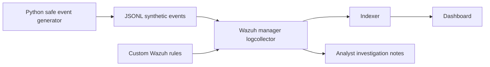

# SOC Detection & Incident Response Lab

**A defensive cybersecurity portfolio project** built around Wazuh SIEM, synthetic security telemetry, reproducible detection rules, and analyst-style investigations.

> **Status:** Starter repository. Offline Python unit tests are included. The full Wazuh integration **must be run and verified on your computer** before claiming a live SIEM deployment. Replace the placeholder GitHub username and add authentic evidence only after validation.

## Why this project exists

This project demonstrates a realistic, limited SOC workflow: ingest logs → identify suspicious behavior → validate alerts → investigate → document conclusions and limitations. It uses **harmless, synthetic events**; it does not carry out attacks or execute malware.

## Detection scenarios

| Scenario | Rule(s) | ATT&CK | Expected result |
| --- | --- | --- | --- |
| Repeated authentication failures from a single source | `100100` → `100101` | T1110 | 5 matching events within 60 s can trigger correlation |
| Synthetic encoded PowerShell execution indicator | `100110` | T1059.001 | 1 alert on test event |

> ATT&CK IDs are detection hypothesis mappings, not proof of malicious activity or complete ATT&CK coverage. Detection rules require tuning against real telemetry.

## Architecture



The Docker stack is supplied by the **official Wazuh project**, cloned locally (not vendored into this repository). Your own work consists of detection rules, test cases, deployment helper scripts, and analyst documentation.

## Requirements (Windows 10/11)

- PowerShell 5.1+; Python 3.10+ for the synthetic generator/tests; Git.
- Docker Desktop using **WSL2 Linux containers** (Docker Desktop license conditions may vary by organization; personal use is generally free).
- Wazuh single-node deployment: **4 CPU cores, at least 8 GB RAM available to Docker, and 50 GB free disk**, per Wazuh documentation. More memory on the host is recommended.
- Internet only for first downloads of official Wazuh sources/images; Python unit tests run offline without dependencies.
- Local testing only. Do not expose Wazuh ports to untrusted networks or reuse demonstration credentials.

## Fast start: offline tests first (no Docker)

Open PowerShell in the extracted project directory:

```powershell
py -3 --version
py -3 -m unittest discover -s tests -v
py -3 scripts/generate_events.py --scenario all --out samples/generated-events.jsonl
py -3 scripts/analyze_events.py samples/generated-events.jsonl
```

Expected: tests pass; generated events have `event_type`, and the analyzer reports an authentication-failure burst and one PowerShell indicator. The Python analyzer is a **local oracle**, not an implementation of Wazuh's own correlation engine.

## Wazuh Docker deployment on Windows

First, install WSL2 and Docker Desktop and start Docker Desktop. Run:

```powershell
wsl --status
docker version
docker compose version
```

If WSL isn't installed, see the official Microsoft documentation linked below. Before running the bootstrap, check the WSL2 kernel setting below. Then, with Docker Desktop open, run:

```powershell
.\scripts\setup-wazuh.ps1
```

This helper downloads the pinned official Wazuh Docker repository, configures the manager to watch a dedicated JSONL file, generates self-signed certificates, and starts its single-node stack. It **does not** install software on your system automatically; Docker Desktop, Python and Git must already be available. If PowerShell execution policy blocks the local script, inspect it and use a process-scoped policy change only if you choose to.

**On WSL2 hosts**, `vm.max_map_count` must be at least 262144. From Windows PowerShell, for a regular WSL Linux distribution:

```powershell
wsl -d Ubuntu -u root -- sysctl -w vm.max_map_count=262144
```

Use your actual WSL distribution name (`wsl --list --verbose`), and confirm the setting in the Linux kernel running Docker; WSL/Docker Desktop arrangements vary. Run this **before** starting the stack; settings can reset after reboot. If the indexer will not start, check the Wazuh docs and the kernel setting. An Ubuntu distro may need to be installed separately.

After the services start, open `https://localhost` (self-signed certificate warning expected). The official demo configuration commonly uses `admin` / `SecretPassword`—**change defaults before any nonlocal usage**; avoid publicly exposing the lab. See the Wazuh password-change documentation.

Install custom rules into the running Wazuh manager and restart it:

```powershell
.\scripts\install-rules.ps1
```

Generate test telemetry, then submit it to the manager logcollector:

```powershell
py -3 scripts/generate_events.py --scenario all --out samples/generated-events.jsonl
.\scripts\ingest-events.ps1
```

In the dashboard, find alerts with `rule.id` in `100100`, `100101`, `100110`, or `data.lab` matching `soc-portfolio` (the exact field location/index view may differ). Check the manager logs and Wazuh logtest if no events appear. Wait for indexing and refresh the dashboard time range. Record observed alerts with timestamps and screenshots, including any deviations from expectations.

### Troubleshooting

```powershell
cd external/wazuh-docker/single-node
docker compose ps
docker compose logs --tail=100 wazuh.manager
docker compose logs --tail=100 wazuh.indexer
docker compose logs --tail=100 wazuh.dashboard
```

You can check the Wazuh rule engine interactively (paste a single JSON line from `samples/generated-events.jsonl`):

```powershell
docker compose exec wazuh.manager /var/ossec/bin/wazuh-logtest
```

Stop the stack without destroying your data:

```powershell
cd external/wazuh-docker/single-node
docker compose down
```

Avoid `docker compose down -v` unless you intentionally want to permanently delete local SIEM data.

## What to publish after a successful run

1. Screenshot of dashboard alerts with private details removed (`docs/evidence/`).
2. A real alert JSON excerpt with timestamps, rule ID and synthetic source IP.
3. Filled-in [`investigations/incident-001.md`](investigations/incident-001.md), distinguishing simulated facts from analyst interpretation.
4. A short test matrix: expected detection vs observed detection, including false positives and limitations.
5. A paragraph on what you would improve (thresholds, distinct source IPs, EDR endpoint telemetry, KQL/Sigma).

Do **not** upload private credentials, real corporate logs or screenshots with personal data.

## Project files

- [`rules/soc_lab_rules.xml`](rules/soc_lab_rules.xml): Wazuh custom rules.
- [`scripts/generate_events.py`](scripts/generate_events.py): safe deterministic event generator.
- [`scripts/analyze_events.py`](scripts/analyze_events.py): local log analysis/reference behavior.
- [`scripts/setup-wazuh.ps1`](scripts/setup-wazuh.ps1): official Wazuh Docker bootstrap.
- [`scripts/install-rules.ps1`](scripts/install-rules.ps1): custom rule install.
- [`scripts/ingest-events.ps1`](scripts/ingest-events.ps1): feed synthetic telemetry.
- [`tests/`](tests/): automated checks.
- [`docs/threat-model.md`](docs/threat-model.md): scope and assumptions.
- [`docs/detection-validation.md`](docs/detection-validation.md): validation checklist.

## References

- [Wazuh official Docker documentation](https://documentation.wazuh.com/current/deployment-options/docker/wazuh-container.html)
- [Wazuh custom rules](https://documentation.wazuh.com/current/user-manual/ruleset/rules/custom.html)
- [Wazuh rule testing](https://documentation.wazuh.com/current/user-manual/ruleset/testing.html)
- [Microsoft WSL installation](https://learn.microsoft.com/en-us/windows/wsl/install)
- [MITRE ATT&CK T1110](https://attack.mitre.org/techniques/T1110/)
- [MITRE ATT&CK T1059.001](https://attack.mitre.org/techniques/T1059/001/)

## License

MIT for original content in this repository. Wazuh and other upstream tools have their **own** licenses; cloning them does not relicense those projects.
