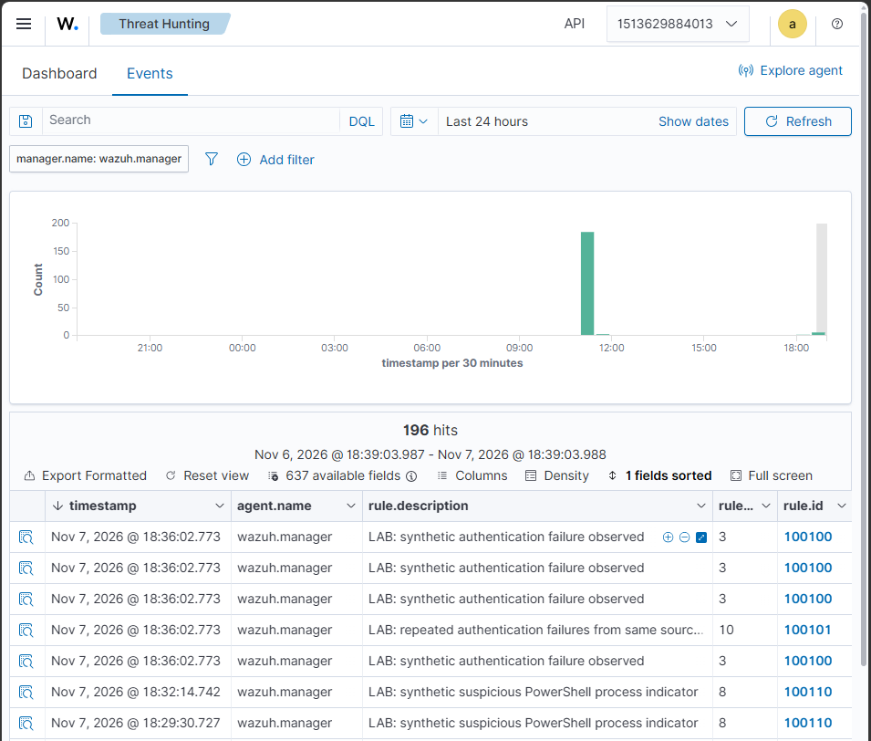
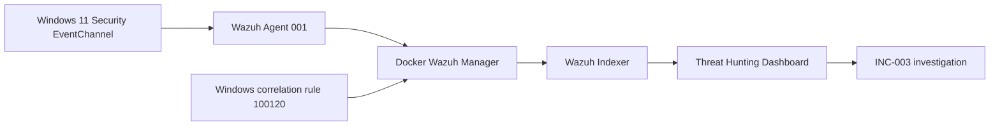
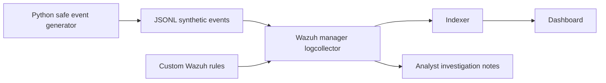

# SOC Detection & Incident Response Lab

**A defensive cybersecurity portfolio project** built around Wazuh SIEM, Windows endpoint telemetry, safe synthetic test data, reproducible detection rules, and analyst-style investigations.

> **Status (8 November 2026): Phases 1–4 validated in a controlled lab.** Phase 1 covers synthetic detections; Phase 2 covers genuine Windows security telemetry; Phase 3 covers Sysmon process creation and encoded PowerShell rules; Phase 4 covers investigative triage, Sysmon FileCreate detection, same-process attribution, and an **offline** Python correlation engine. The full local suite passed **25/25 tests**. No real attack or compromise occurred.

## Why this project exists

This project demonstrates a realistic, limited SOC workflow: ingest logs → identify suspicious behavior → validate alerts → investigate → document conclusions and limitations. It uses **harmless synthetic JSON test records** in Phase 1 and **controlled, real Windows Security events** in Phase 2; it does not carry out attacks or execute malware.

## Phase 1 — Verified synthetic detection results

Tested on **7 November 2026** using the official Wazuh **4.14.10** single-node Docker stack on Windows + Docker Desktop/WSL2. Events were injected as synthetic JSON lines into `/var/ossec/logs/lab-events.jsonl`. Wazuh decoded, correlated where applicable, and indexed the corresponding alerts.

| Scenario | Wazuh rule | Level | MITRE ATT&CK | Observed result |
| --- | --- | --- | --- | --- |
| Individual simulated failed login | `100100` | 3 | T1110 | Base authentication-failure events visible in dashboard |
| **Five failed logins** from `192.0.2.44` within the correlation window | **`100101`** | **10** | **T1110 — Brute Force** | **Frequency-5 correlation fired; indexed alert verified** |
| Synthetic suspicious PowerShell process indicator | **`100110`** | **8** | **T1059.001 — PowerShell** | **Custom rule fired; indexed alert verified** |

The observed synthetic authentication events referenced `demo_user` and `demo-win01`; the source IP `192.0.2.44` is an RFC 5737 documentation address. The PowerShell scenario described suspicious process metadata only—**no PowerShell command was executed**.

### Dashboard evidence

| Evidence | Screenshot |
| --- | --- |
| Wazuh Threat Hunting overview showing lab alerts | [Detection overview](screenshots/detection-overview.png) |
| Correlated authentication-failure alert (`100101`, level 10) | [Brute-force alert](screenshots/brute-force-alert.png) |
| Suspicious PowerShell indicator (`100110`, level 8) | [PowerShell alert](screenshots/powershell-alert.png) |



### SOC investigation write-ups

- [INC-001 — Repeated authentication failures (controlled simulation)](investigations/INC-001-brute-force-simulation.md)
- [INC-002 — Suspicious PowerShell indicator (controlled simulation)](investigations/INC-002-powershell-simulation.md)

**Scope and limitations:** These results verify synthetic log collection, JSON decoding, rule evaluation, frequency correlation, alert indexing, and dashboard visibility. They do **not** validate authentication against a real service, Windows endpoint telemetry, real PowerShell execution, incident containment, or a real-world compromise. ATT&CK mappings are hypotheses for detection coverage, not evidence of a completed attack.

## Phase 2 — Real Windows endpoint detection (validated 8 November 2026)

A Windows 11 endpoint running Wazuh agent **`001`** (`soc-win-endpoint`) was enrolled against the same Docker-hosted Wazuh manager. The endpoint collected real **Windows EventChannel** logs; unlike Phase 1, no fabricated JSON security events were injected.

| Verified test | Observed rule | Level | Evidence |
| --- | --- | --- | --- |
| Controlled Windows Application error (Event ID `777`) | `60602` | 9 | Wazuh received and alerted on the genuine Application-channel event |
| One deliberately failed local Windows logon (Security Event ID `4625`) | `60122` | 5 | Built-in failed-logon alert visible for agent `001` |
| **Five failed local logons for the same nonexistent username within 60 seconds** | **Custom `100120`** | **10** | **Frequency-5 correlation alert verified in dashboard and manager alerts; triggered on two test runs** |

The failed-logon tests called the Windows `LogonUser` API with the **nonexistent** `SOC_LAB_NONEXISTENT` account and an intentionally fake password. Windows recorded authentic Security Event ID `4625` events (interactive logon type `2`, unknown-user substatus `0xC0000064`). Wazuh decoded these via `windows_eventchannel`; its built-in rule `60122` generated level-5 alerts. Our `100120` rule correlated the failures for the same **target username**, mapped to **MITRE ATT&CK T1110 — Brute Force**.

- **Custom detection rule:** [`rules/windows_auth_rules.xml`](rules/windows_auth_rules.xml)
- **Investigation and sanitized evidence:** [INC-003 — Windows failed-logon correlation](investigations/INC-003-windows-authentication.md)
- **Observed correlated alerts:** 2026-11-08 17:48:55 CET and 17:50:28 CET (16:48:55 and 16:50:28 UTC).

**Scope:** This confirms true Windows-to-agent-to-SIEM detection and five-event correlation in a controlled environment, **not** a real brute-force attack. The test did not involve a remote source IP, real compromised account, malicious PowerShell, or actual adversary activity. Additional negative tests and tuning are required before production use.

### Phase 2 screenshot and privacy note

**No Phase 2 screenshots are published.** Unlike the synthetic Phase 1 evidence, the real Windows EventChannel and Wazuh dashboard views contained personal system identifiers (such as hostnames, Windows account names, SIDs, and logon identifiers). To avoid exposing information from the personal test system, those screenshots were intentionally omitted. Instead, [INC-003](investigations/INC-003-windows-authentication.md) documents the observed rule IDs, timestamps, validation steps, and a **sanitized, reconstructed alert excerpt**; that excerpt is not represented as an unmodified raw event. The absence of screenshots is a privacy precaution, not a claim of additional validation.

### Phase 2 architecture



## Phase 3 — Sysmon endpoint telemetry (initial validation, 8 November 2026)

Windows built-in Sysmon was enabled with a **minimal process-creation filter**, initially limited to `notepad.exe` and subsequently expanded to `powershell.exe` and `pwsh.exe`. The Windows Wazuh agent (`001`) collected events from `Microsoft-Windows-Sysmon/Operational` and forwarded them to the Docker-hosted Wazuh manager. A harmless Notepad launch generated a genuine Sysmon **Event ID 1**. The custom rule **`100130`** (level 5) matched it, and the corresponding alert was verified in the Wazuh dashboard with decoder `windows_eventchannel` and agent `001`.

- **Detection rules:** [`rules/sysmon_rules.xml`](rules/sysmon_rules.xml) (`100130` Notepad, `100131` controlled PowerShell marker, `100132` encoded-command indicator, and `100133` combined-flag indicator).
- **Outcome:** PASS for the controlled end-to-end Notepad process-creation test. **PASS** for a second test in which `powershell.exe -NoProfile -Command "Write-Output 'SOC_LAB_PHASE3_TEST'"` generated a genuine Sysmon Event ID `1`, and custom rule `100131` (level 5) appeared in the Wazuh dashboard for agent `001` (observed 8 November 2026, 21:08:50 UTC). Both tests validate telemetry collection and rule matching, **not** malicious activity.
- **Encoded PowerShell validation:** A harmless UTF-16LE Base64 command launched using `-EncodedCommand` was collected as Sysmon Event ID `1`. The built-in Wazuh rule `92057` (level 12) was seen in an initial PowerShell-parent test. A subsequent `cmd.exe`-parent test produced **custom rule `100132` (level 8)** in the dashboard at 2026-11-08 21:18:04 UTC. See [INC-004 — Encoded PowerShell process creation](investigations/INC-004-powershell-encoded-command.md). These are technique-indicator tests, not malicious activity.
- **Combined-flag detection:** A harmless `-EncodedCommand` test with `-NoProfile` and `-NonInteractive` triggered custom **rule `100133`, level 10**, on 8 November 2026 at 22:31:22 CET. Follow-up tests each omitted one required option and the dashboard showed two `100132` (level 8) alerts and one built-in `92032` (level 3) alert, with no additional `100133` visible in the supplied time-window screenshot. These are controlled flag-pattern tests, not proof of malicious activity.
- **Privacy:** No unredacted Phase 3 dashboard screenshots or raw Windows logs are published because the telemetry includes personal endpoint identifiers (for example account and computer names, GUIDs, and file paths). The summary above contains selected non-sensitive validation fields only.
- **Not yet tested:** broad false-positive rate, all abbreviated switch variants, additional suspicious PowerShell behaviors, and production readiness.

## Phase 4 — Threat hunting, tuning and offline correlation (validated 8 November 2026)

Phase 4 investigated suspicious-looking PowerShell activity in a known-benign lab. Sysmon Event ID `1` captured process creation and Event ID `11` captured controlled file creation, using narrowly scoped filters. Wazuh generated custom rules `100133` (PowerShell encoded flags, level 10) and `100134` (controlled file creation, level 5). Alerts for the same process were linked by **agent ID + ProcessGuid**.

| Validation | Outcome |
| --- | --- |
| Controlled file creation and ProcessGuid attribution | PASS — matching Sysmon Event IDs 1 and 11 |
| Same-process real Wazuh alert correlation | PASS — `100133` + `100134`, 0.197-second interval, one finding |
| Different-process real Wazuh negative control | PASS — two alerts, zero findings |
| Benign encoded administration | `100133` triggered; flagged activity was not malicious |
| Offline regression suite | **25 tests passed**, 0 failures |

**Architecture:** Windows Sysmon → Wazuh manager alert indexing → manually selected local alert batch → [offline Python correlator](tools/sysmon_correlator.py) → sanitized investigation finding. The correlator requires matching agent and ProcessGuid within 60 seconds. It is **not** a continuously running Wazuh correlation rule or production SOC service. An experimental Wazuh native rule `100135` failed validation and was removed; it was not deployed.

**Privacy:** Phase 4 publishes no raw endpoint event dumps, screenshots, usernames, hostnames or process GUIDs. See [INC-005 — process-chain triage and correlation](investigations/INC-005-process-chain-triage.md), [file creation rule](rules/sysmon_file_rules.xml), and the [validation matrix](docs/detection-validation.md).

## Phase 5 — Read-only incremental monitoring (live test validated)

The new [incremental correlator](tools/sysmon_stream.py) retains matching `100133` and `100134` alerts across incoming batches in **memory only**, using agent ID, ProcessGuid, event timestamps, a 60-second match window and bounded out-of-order handling. It suppresses duplicate findings within the retained window, expires old state, and fails with an error instead of silently discarding alerts when the configured key limit is exceeded. The [NDJSON monitor](tools/phase5_monitor.py) consumes alert lines from standard input and emits **sanitized findings only**. Twelve [regression tests](tests/test_sysmon_stream.py) cover positive and negative joins, duplicates, ordering, malformed alerts, privacy, expiration, and capacity.

**Status:** Local full test suite **37/37 PASS** on 8 November 2026 (0 failures, 0.007 seconds); controlled live-stream correlation **PASS** (one sanitized finding, 0.189-second separation). This monitor is session-scoped (no persisted offset or checkpoint). Restarting it clears correlation and deduplication state; out-of-order events beyond the configured lateness may be missed, and a long idle period does not by itself expire state. It does not modify Wazuh configuration, contain endpoints, or send notifications.

**Read-only streaming test** (run from repository root and stop with Ctrl+C):

```powershell
cmd.exe /d /c "docker exec single-node-wazuh.manager-1 tail -n 0 -F /var/ossec/logs/alerts/alerts.json | py -3 -u -m tools.phase5_monitor"
```

**Live validation:** Wazuh indexed rules `100133` and `100134` for a harmless test; the streaming monitor generated **one sanitized finding** with `delta_seconds: 0.189`, `guid_match: true`, and `agent_match: true`. Direct piping with Windows PowerShell had shown no findings; using `cmd.exe` to host the native Docker→Python pipe successfully delivered live events. Restart recovery, persistent checkpoints and long-running reliability remain untested.

### Step 3 — Restart-safe snapshot replay prototype (controlled test passed)

The [checkpoint prototype](tools/phase5_checkpoint.py) reads a **local snapshot** of Wazuh `alerts.json`, replays an append-only log from the beginning, verifies its prior prefix against a rolling SHA-256 digest, and atomically writes progress and pseudonymized correlation state to a separate checkpoint. It fails closed if the source is truncated or a previously processed line changes. Raw usernames, hostnames, GUIDs, and commands are **not saved in the checkpoint**; only a secret key and HMAC-pseudonymized agent/process identities remain. Seven [recovery tests](tests/test_phase5_checkpoint.py) cover restart, changed/truncated logs, incomplete lines, sensitive data, checkpoint versions, and duplicate replay.

This is a **bounded snapshot-recovery prototype, not a production tailer or guaranteed exactly-once notification system**: it does not follow new file writes, recover after Wazuh rotation, lock against concurrent monitor processes, or make console printing atomic with checkpoint commits. If interrupted after checkpointing but before printing, a finding may be lost from console output. A local snapshot includes sensitive raw alerts and must remain outside the public Git repository. For a controlled test, use a sanitized test fixture rather than exporting your raw logs.

To validate code and tests, synchronize GitHub and run `py -3 -m unittest discover -s tests -v`. The local test suite completed successfully on **8 November 2026: 44/44 tests PASS, 0 failures, in 0.042 seconds** (37 existing + 7 checkpoint tests). The operator also completed a manual three-run synthetic restart test: the first run saved a pending `100133` event with no output; a second run restored the checkpoint and correlated a newly appended `100134` event into **one sanitized finding** (`delta_seconds: 0.197`); a third replay of the unchanged source emitted **zero duplicate findings**. **PASS — controlled snapshot checkpoint/restart behavior**, not production crash recovery.

### Step 4 — Durable findings outbox (prototype, pending tests)

The [checkpoint processor](tools/phase5_checkpoint.py) now commits **sanitized findings to a local pending outbox in the same atomic state-file replacement as the input cursor and correlation state**. After restarting, unacknowledged findings can be listed again. Explicit acknowledgment deletes only the selected pending finding; the tool does **not** automatically acknowledge when it prints. Existing version-1 checkpoints without an outbox remain readable.

**Usage** (run from repository root; keep the source JSONL and checkpoint **outside Git**):

```powershell
py -3 -m tools.phase5_checkpoint --input C:\SOC-Lab\phase5-checkpoint-demo.jsonl --state C:\SOC-Lab\phase5-checkpoint-demo.state.json
py -3 -m tools.phase5_checkpoint --pending --state C:\SOC-Lab\phase5-checkpoint-demo.state.json
py -3 -m tools.phase5_checkpoint --ack 1 --state C:\SOC-Lab\phase5-checkpoint-demo.state.json
```

The processor prints each pending finding with an integer `id`. A finding remains pending across restarts until explicitly acknowledged. **Only acknowledge a finding after verifying it was recorded by the intended downstream analyst or system**. If the process crashes after saving but before the output reaches its consumer, the finding will be shown again: **at-least-once review is possible, but duplicates must be handled downstream**. Console output, an external notification, and acknowledgment are not one atomic transaction. The prototype does not yet prevent simultaneous writers or support log rotation. Restrict local checkpoint access, as it contains secret pseudonymization key material.

Six additional [outbox tests](tests/test_phase5_checkpoint.py) cover restart recovery, replay without duplicates, acknowledgement persistence, invalid acknowledgment, identifier redaction, and compatibility with older checkpoints. **Verified locally on 8 November 2026: 50/50 tests passed, 0 failures, in 0.227 seconds.** Manual outbox review and acknowledgment remain to be validated.

**Manual outbox lifecycle validation (8 November 2026): PASS.** A fresh synthetic checkpoint processed rules `100133` and `100134` into one pending finding (`id=1`, `delta_seconds=0.197`). A separate `--pending` execution returned the same finding. After `--ack 1`, a subsequent `--pending` returned no findings. This demonstrates controlled pending/replay/acknowledgment behavior, not concurrent-writer safety or exactly-once delivery.

### Step 5 — Checkpoint single-writer lock (prototype, pending local tests)

The checkpoint CLI now acquires a **non-blocking operating-system file lock** on `<state>.lock` before loading any saved checkpoint data. The lock stays held while reading the source, committing updated state, listing findings, or acknowledging a finding. A second CLI process targeting the same checkpoint **fails immediately** with `checkpoint is in use by another process`, rather than overwriting state loaded by the first. The lock is released automatically when the process exits or crashes; the `.lock` file intentionally remains on disk and **must not be manually deleted**.

The lock uses Windows byte-range locking (`msvcrt`) on Windows and `flock` on POSIX. It protects **cooperating CLI users on a local filesystem**; code that directly instantiates `SnapshotCheckpoint` without acquiring the lock is **not guarded**. It is not a distributed lock, and network filesystem behavior has not been validated.

Three [cross-process regression tests](tests/test_checkpoint_lock.py) check contention, release/reacquisition, and abnormal process exit. **Verified locally: 53/53 tests passed, 0 failures, in 0.168 seconds.** Manual two-terminal contention validation remains pending.

**Manual Windows two-terminal lock validation: PASS.** While one process held the checkpoint lock, a second CLI attempt returned `checkpoint is in use by another process`. After the first process released the lock, the same CLI query completed without an error and returned no pending findings, consistent with the previously acknowledged synthetic finding. This confirms cooperative single-writer locking for the tested local Windows setup; it is not evidence of distributed or uncooperative-access safety.

## Architecture



The Docker stack is supplied by the **official Wazuh project**, cloned locally (not vendored into this repository). Phase 1 uses manager-local synthetic records; Phase 2 uses a Windows host agent and real EventChannel records. Your own work consists of detection rules, test cases, deployment helper scripts, and analyst documentation.

## Requirements (Windows 10/11)

- PowerShell 5.1+; Python 3.10+ for the synthetic generator/tests; Git.
- Docker Desktop using **WSL2 Linux containers** (Docker Desktop license conditions may vary by organization; personal use is generally free).
- Wazuh single-node deployment: **4 CPU cores, at least 8 GB RAM available to Docker, and 50 GB free disk**, per Wazuh documentation. More memory on the host is recommended.
- Internet only for first downloads of official Wazuh sources/images; Python unit tests run offline without dependencies.
- Local testing only. Do not expose Wazuh ports to untrusted networks or reuse demonstration credentials.

## Fast start: offline tests first (no Docker)

Open PowerShell in the extracted project directory:

```powershell
py -3 --version
py -3 -m unittest discover -s tests -v
py -3 scripts/generate_events.py --scenario all --out samples/generated-events.jsonl
py -3 scripts/analyze_events.py samples/generated-events.jsonl
```

Expected: tests pass; generated events have `event_type`, and the analyzer reports an authentication-failure burst and one PowerShell indicator. The Python analyzer is a **local oracle**, not an implementation of Wazuh's own correlation engine.

## Wazuh Docker deployment on Windows

First, install WSL2 and Docker Desktop and start Docker Desktop. Run:

```powershell
wsl --status
docker version
docker compose version
```

If WSL isn't installed, see the official Microsoft documentation linked below. Before running the bootstrap, check the WSL2 kernel setting below. Then, with Docker Desktop open, run:

```powershell
.\scripts\setup-wazuh.ps1
```

This helper downloads the pinned official Wazuh Docker repository, configures the manager to watch a dedicated JSONL file, generates self-signed certificates, and starts its single-node stack. It **does not** install software on your system automatically; Docker Desktop, Python and Git must already be available. If PowerShell execution policy blocks the local script, inspect it and use a process-scoped policy change only if you choose to.

**On WSL2 hosts**, `vm.max_map_count` must be at least 262144. From Windows PowerShell, for a regular WSL Linux distribution:

```powershell
wsl -d Ubuntu -u root -- sysctl -w vm.max_map_count=262144
```

Use your actual WSL distribution name (`wsl --list --verbose`), and confirm the setting in the Linux kernel running Docker; WSL/Docker Desktop arrangements vary. Run this **before** starting the stack; settings can reset after reboot. If the indexer will not start, check the Wazuh docs and the kernel setting. An Ubuntu distro may need to be installed separately.

After the services start, open `https://localhost` (self-signed certificate warning expected). The official demo configuration commonly uses `admin` / `SecretPassword`—**change defaults before any nonlocal usage**; avoid publicly exposing the lab. See the Wazuh password-change documentation.

Install custom rules into the running Wazuh manager and restart it:

```powershell
.\scripts\install-rules.ps1
```

Generate test telemetry, then submit it to the manager logcollector:

```powershell
py -3 scripts/generate_events.py --scenario all --out samples/generated-events.jsonl
.\scripts\ingest-events.ps1
```

In the dashboard, find alerts with `rule.id` in `100100`, `100101`, `100110`, or `data.lab` matching `soc-portfolio` (the exact field location/index view may differ). Check the manager logs and Wazuh logtest if no events appear. Wait for indexing and refresh the dashboard time range. Record observed alerts with timestamps and screenshots, including any deviations from expectations.

### Troubleshooting

```powershell
cd external/wazuh-docker/single-node
docker compose ps
docker compose logs --tail=100 wazuh.manager
docker compose logs --tail=100 wazuh.indexer
docker compose logs --tail=100 wazuh.dashboard
```

You can check the Wazuh rule engine interactively (paste a single JSON line from `samples/generated-events.jsonl`):

```powershell
docker compose exec wazuh.manager /var/ossec/bin/wazuh-logtest
```

Stop the stack without destroying your data:

```powershell
cd external/wazuh-docker/single-node
docker compose down
```

Avoid `docker compose down -v` unless you intentionally want to permanently delete local SIEM data.

## Validation evidence and next improvements

**Completed:** Both Phase 1 custom scenarios passed the Wazuh pipeline, and Phase 2 confirmed real Windows EventChannel ingestion plus custom five-event correlation. The findings are documented in the investigation reports linked above. The earlier offline Python reference analyzer and unit tests provide additional checks, but are not substitutes for SIEM integration validation.

**Next validation work:**
1. Test negative cases (unrelated JSON events and distinct source IPs) and update [the validation matrix](docs/detection-validation.md), which still contains a **pre-integration checklist**.
2. Move the existing Windows endpoint tests into an isolated lab VM, and expand coverage to network authentication with source attribution.
3. Tune rule conditions and thresholds against representative benign activity and document false positives.
4. Add sanitized alert JSON excerpts and repeatable evidence-capture steps.

Do **not** commit credentials, generated certificates, actual corporate logs or private information.

## Project files

- [`rules/soc_lab_rules.xml`](rules/soc_lab_rules.xml): Wazuh custom rules.
- [`scripts/generate_events.py`](scripts/generate_events.py): safe deterministic event generator.
- [`scripts/analyze_events.py`](scripts/analyze_events.py): local log analysis/reference behavior.
- [`scripts/setup-wazuh.ps1`](scripts/setup-wazuh.ps1): official Wazuh Docker bootstrap.
- [`scripts/install-rules.ps1`](scripts/install-rules.ps1): custom rule install.
- [`scripts/ingest-events.ps1`](scripts/ingest-events.ps1): feed synthetic telemetry.
- [`tests/`](tests/): automated checks.
- [`docs/threat-model.md`](docs/threat-model.md): scope and assumptions.
- [`docs/detection-validation.md`](docs/detection-validation.md): validation matrix for both completed phases and outstanding negative tests.
- [`investigations/INC-001-brute-force-simulation.md`](investigations/INC-001-brute-force-simulation.md): authentication-correlation case study.
- [`investigations/INC-002-powershell-simulation.md`](investigations/INC-002-powershell-simulation.md): suspicious PowerShell telemetry case study.
- [`screenshots/`](screenshots/): Wazuh Threat Hunting evidence from Phase 1.
- [`rules/windows_auth_rules.xml`](rules/windows_auth_rules.xml): validated Phase 2 Windows Event ID 4625 correlation rule.
- [`rules/sysmon_rules.xml`](rules/sysmon_rules.xml): Phase 3 custom Sysmon process creation rules.
- [`investigations/INC-004-powershell-encoded-command.md`](investigations/INC-004-powershell-encoded-command.md): sanitized Phase 3 PowerShell detection investigation.
- [`investigations/INC-003-windows-authentication.md`](investigations/INC-003-windows-authentication.md): Phase 2 investigation and sanitized detection evidence.

## References

- [Wazuh official Docker documentation](https://documentation.wazuh.com/current/deployment-options/docker/wazuh-container.html)
- [Wazuh custom rules](https://documentation.wazuh.com/current/user-manual/ruleset/rules/custom.html)
- [Wazuh rule testing](https://documentation.wazuh.com/current/user-manual/ruleset/testing.html)
- [Microsoft WSL installation](https://learn.microsoft.com/en-us/windows/wsl/install)
- [MITRE ATT&CK T1110](https://attack.mitre.org/techniques/T1110/)
- [MITRE ATT&CK T1059.001](https://attack.mitre.org/techniques/T1059/001/)

## License

MIT for original content in this repository. Wazuh and other upstream tools have their **own** licenses; cloning them does not relicense those projects.
