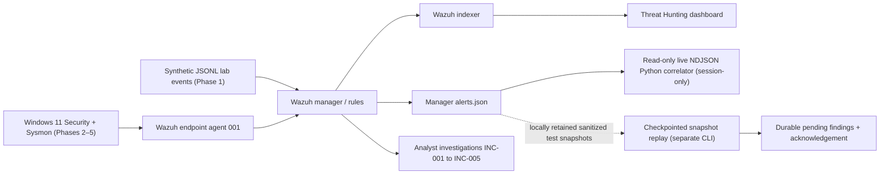

# Architecture — SOC Detection & Incident Response Lab

This page reflects the **five-phase validated portfolio scope**. It distinguishes the real Wazuh alert path from standalone Python analysis and recovery prototypes.

- **Detection:** Wazuh XML rules detect synthetic failed logons, real Windows Security Event ID 4625, Sysmon Event ID 1 and targeted Event ID 11 file creation.
- **Correlation:** Python links custom rule `100133` (encoded PowerShell with flags) and `100134` (controlled file creation) when agent ID and ProcessGuid match within 60 seconds.
- **Live path:** `tools/phase5_monitor.py` reads new Wazuh JSONL alerts from stdin and prints sanitized findings. This mode has **no persisted state**.
- **Snapshot recovery path:** `tools/phase5_checkpoint.py` supports an append-only local file or manually ordered retained `--segments` (including `.gz`). State includes pseudonymized correlation keys, cursor digest and pending findings, protected by a cooperating CLI lock.
- **Separation:** These two Python paths are **not one integrated, always-on daemon**. Recovery across log rotation requires operator-supplied retained history; automatic rotation discovery, external delivery guarantees, throughput/availability testing and endpoint response are **out of scope**.
- **Privacy:** Real endpoint alert JSONL is sensitive. Public documentation uses selected sanitized fields; raw Windows logs, real ProcessGuids, system paths and unredacted Phase 2–4 dashboard screenshots are withheld.

See [validation matrix](../docs/detection-validation.md) and the [main README](../README.md).
